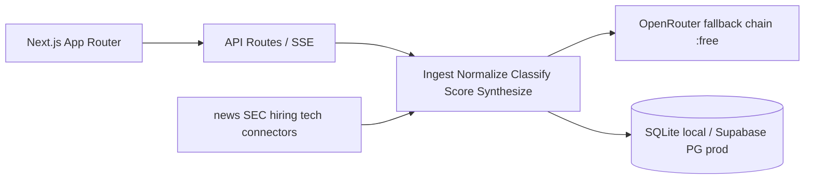

# Pulse — Customer Intelligence Agent

> What is happening inside my customer's org? What useful thing can I say today, and to whom?

60-second quick start (local, no key):

```bash
npm install
cp .env.example .env
npm run db:seed
npm run dev
# open http://localhost:3000/login — password: pulse-demo-1234
```

Demo Mode ships 3 companies (Microsoft, Starbucks, Acme Robotics) with cited insights. No OpenRouter key needed.

## Deploy (Vercel + Supabase CLI)

```bash
supabase init        # repo already has supabase/config.toml
supabase start       # local pg for parity
supabase db push     # after setting DIRECT_URL / DATABASE_URL
vercel link && vercel env add DATABASE_URL && vercel --prod
```

- `DB_DRIVER=sqlite` locally (node:sqlite, zero native deps), `DB_DRIVER=postgres` in prod.
- Single-user gate via `APP_PASSWORD` + httpOnly cookie (`middleware.ts`). Same password on Vercel.
- Cron: `vercel.json` → `/api/cron/digest` (protected by `CRON_SECRET`).

## Architecture



Free-model hardening: zod schemas, repair retry, fallback on 429, backoff, in-DB http cache, cost summary ($0).

## Add a connector

Implement `fetchSignals(company, sinceDate)` in `connectors/my-source.ts`, add to `connectors/registry.ts`, add tests. Per-connector timeout/retry via `connectors/http.ts`.

## Limitations

- Phase 0: demo data only, no live LLM. Live pipeline in Phase 1.
- Vercel Hobby timeout ~60s — long runs move to SSE chunks / Render worker in Phase 4.
- No LinkedIn scraping; role + deep links only.

Screenshots: `public/` placeholders — add GIFs after Phase 2.
